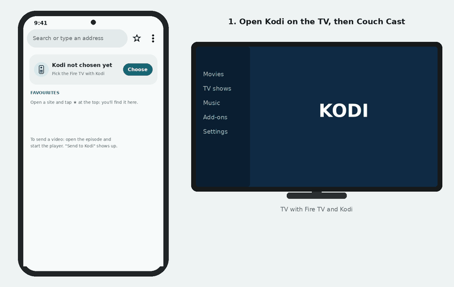
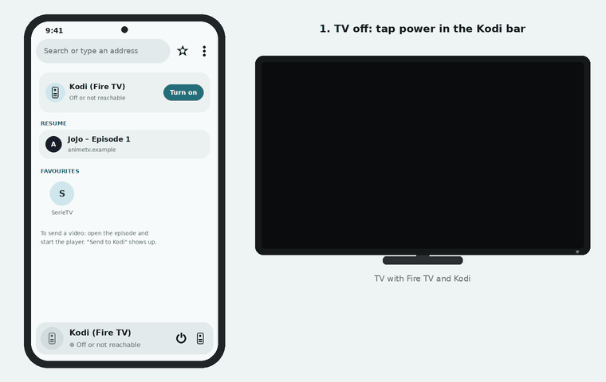
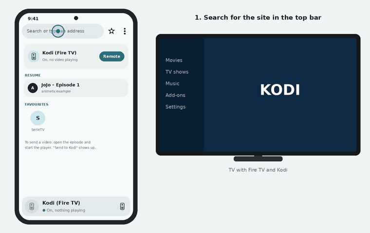
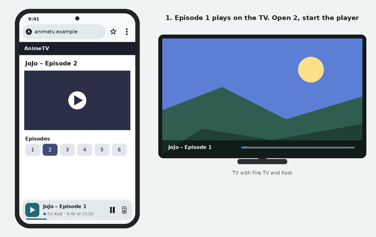
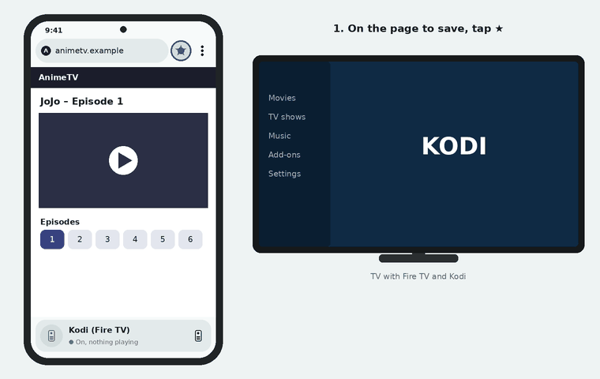

# 📖 How to use Couch Cast

[🇮🇹 Italiano](TUTORIAL.md) · 🇬🇧 English

A step-by-step guide, without technical terms. If something goes wrong, jump to [Common problems](#-common-problems).

**The idea in one line:** the phone is the browser and the remote, the TV shows the video with **Kodi**. You open the site
on the phone, start the video, press a button and the video plays on the TV. Then you can lock the phone.

> [!IMPORTANT]
> Phone and Fire TV must be connected **to the same Wi-Fi**.

> [!NOTE]
> The app is in English and Italian: it follows the phone's language (Italian only if the phone is in Italian), and you
> can change it in **⋮ → Settings → App language**. This guide uses the English names. The animations are drawings of
> the version 2.1 interface, not screen recordings: colours and details of the real app may differ a little.

## Contents

1. [What's on the screen](#1-whats-on-the-screen)
2. [First time: set up the Fire TV](#2-first-time-set-up-the-fire-tv)
3. [First time: connect the app to Kodi](#3-first-time-connect-the-app-to-kodi)
4. [Turn the TV on from the phone](#4-turn-the-tv-on-from-the-phone)
5. [Find and open a video](#5-find-and-open-a-video)
6. [Send the video to the TV](#6-send-the-video-to-the-tv)
7. [The episode queue](#7-the-episode-queue)
8. [Favourites](#8-favourites)
9. [Kodi log: when something doesn't play](#9-kodi-log-when-something-doesnt-play)
10. [Update the app and make a backup](#10-update-the-app-and-make-a-backup)
11. [Common problems](#-common-problems)

---

## 1. What's on the screen

```
┌──────────────────────────────────────────────┐
│ (🌐 animetv.example              🛡3)   ★  ⋮  │  ← top bar
│▬▬▬▬▬▬▬▬▬▬▬▬▬▬▬▬▬▬▬▬                            │  ← page loading
│                                              │
│                 site page                    │
│                                              │
│                 (+≡)  ( 📺 Send to Kodi )     │  ← only when there's a video
│ ╭──────────────────────────────────────────╮ │
│ │ [▶] Episode 11                    ‖   ▯  │ │  ← Kodi bar, always
│ │     ● On Kodi · 12:40 of 23:50           │ │
│ ╰━━━━━━━━━━━━━━━━──────────────────────────╯ │
└──────────────────────────────────────────────┘
```

| Button | What it does |
|---|---|
| **Address bar** ("Search or type an address") | Type a site (`wikipedia.org`) or a search (`jojo episode 1`, goes to Google). The site's icon is on the left. Until you tap it, it shows only the site's name; tapping it brings back the full address. |
| **🛡 with a number** | Shows up when the app blocked popups or jumps to other sites on this page. Tap it to see which ones and open one, if you needed it. |
| **★** | Your favourite sites. Filled if the open page is already a favourite. |
| **Kodi bar** (at the bottom) | Always there, as soon as the app knows where Kodi is. It shows what is playing, with the time, play/pause and a thin line at the bottom that moves forward. The dot next to the status is lit if Kodi answers. If Kodi is on but idle it says *On, nothing playing*; if it is off or not answering there is the **⏻** button to turn the TV on. The button on the right, or a tap on the bar, opens the remote with the queue. |
| **⋮** | A small menu: *Remote*, *Kodi queue*, *Home page*, *Settings* (where Kodi is, power on, next episodes, history, shade, backup, language, Kodi log, guide, version). |
| **Send to Kodi** | Plays the page's video on the TV right away. It shows up at the bottom right, over the site, only when a video starts on the page. |
| **+** (queue: the round icon with lines and a +, next to *Send to Kodi*) | Puts the video at the end of Kodi's queue, without interrupting what you are watching. Long-press it to open the queue. |

On launch the **home page** opens: Kodi at the top (on, off or what it is playing, with a *Turn on* or *Remote* button), then **Keep watching** with the series you are following, the **Last page** you opened and your favourites as icons (see [Keep watching](#keep-watching)). You get back to it with Back from a site's first page or with **⋮ → Home page**.

Short messages ("Added to the queue", "Kodi is ready"…) appear at the bottom of the screen, over the site.

---

## 2. First time: set up the Fire TV

To do **once only**, with the Fire TV remote. The detailed steps to install Kodi are in the
[README](../README.md#-fire-tv); here is what the app needs.

1. **Install Kodi** on the Fire TV (with the *Downloader* app, see README) and open it.
2. In Kodi go to **Settings → Services → Control** and turn on **Allow remote control via HTTP**.
   - Leave the port as it is (usually `8080`).
   - If you set a **username and password**, write them down: the app will ask for them.
3. Still in Kodi, **Settings → Services → General**: turn on **Announce services to other systems**.
   It lets the app find Kodi by itself.
4. Only if you want to turn the TV on from the phone (**⏻** button) and read Kodi's log:
   - Fire TV: **Settings → My Fire TV → Developer options → ADB debugging** = on.
     If *Developer options* is missing, go to **My Fire TV → About** and click the device name 7 times.
   - Fire TV: **Settings → Display & Sounds → HDMI CEC Device Control** = on.
   - On the TV turn on HDMI-CEC (called Anynet+, SimpLink, Bravia Sync… depending on the brand).
     If Alexa already turns the TV on to the right input, it's already fine.

---

## 3. First time: connect the app to Kodi

<p align="center"></p>

1. **Open Kodi on the TV** (it must be on to be found).
2. **Open Couch Cast** on the phone. On first launch the **Where is Kodi?** window appears.
3. **Automatic** tab: the app says *"Looking for Kodi on the Wi-Fi…"* and after a
   few seconds shows what it found. Tap your Kodi and press **Save**.
4. If it finds nothing, use the **Manual** tab and type `IP:port`, for example `192.168.1.50:8080`.
   You can read the IP on the Fire TV in **Settings → My Fire TV → About → Network**.
5. **Login, if set in Kodi**: if you set a username and password in Kodi, type them here. If you skip them, the app asks
   for them by itself (*Kodi login* window) the first time you send a video.

Done: the **Kodi bar** shows up at the bottom, and on the home page the Kodi card shows its name. To change these
choices later: **⋮ → Settings → Kodi**.

> [!TIP]
> - If the Fire TV changes address (it happens after a router restart), the app finds it again by itself when sending.
> - The password stays only on the phone, encrypted, and is tied to the home network: on another network the app asks again.

---

## 4. Turn the TV on from the phone

<p align="center"></p>

With the TV off (in standby) press **⏻** in the Kodi bar at the bottom (or *Turn on* on the home page).

1. The app looks for the Fire TV on the network (*"Looking for the Fire TV on the network…"*), even if Kodi is closed.
2. **Only the first time**: the TV asks whether to allow debugging from this phone.
   Tick **Always allow** and press **OK** with the remote.
3. The TV turns on, after a few seconds switches to the Fire TV input and Kodi opens.
4. When Kodi answers, the phone says **"Kodi is ready"**.

> [!NOTE]
> If the Fire TV is in *deep sleep* (off for a long time) its Wi-Fi is off and it answers no one:
> in that case turn it on with Alexa or the remote.

---

## 5. Find and open a video

<p align="center"></p>

1. Tap the **top bar** and type the site or a search, then press Enter.
   - `wikipedia.org` → opens the site.
   - `jojo episode 1` → searches Google; from Google results you can open any site.
2. Go to the episode or movie page.
3. **Start the player** (press play on the video). This step is essential: the app only sees the video once it starts.
4. At the bottom right, over the site, **Send to Kodi** and the round **+** (queue) button show up. Now you can also pause
   the video on the phone.

### From Chrome or another app: Share → Couch Cast

Found the episode page in Chrome, or someone sent it to you on WhatsApp? Tap **Share** and pick **Couch Cast**: the
page opens in the app and you carry on from step 3 (start the player, then Send to Kodi).

- A message with the link in the middle of the text is fine too: the app takes the first link.
- If you share plain text with no link, the app searches it on Google.
- If the link is already the video (it ends in `.m3u8` or `.mp4`), a panel opens: **Send to Kodi**
  starts it on the TV right away, **Open here** opens it in the app.

> [!TIP]
> Ads that open windows or take you to other sites are blocked silently.
> If the site seems "not to react" to a tap, it was probably an ad link: tap the real play button again.

---

## 6. Send the video to the TV

Press **Send to Kodi**.

- The button says *"Sending to Kodi…"* until Kodi answers: no need to press again.
- When done, **"Sent to Kodi"** appears and the video starts on the TV after a few seconds.
- If the page has more than one video the button says e.g. **Send to Kodi · 2** and a panel opens with all the
  videos, each with a **frame taken from the video** and its **length** on top (after a couple of seconds). The first,
  *Full video*, is almost always the right one: it is already picked, marked *Recommended*,
  with the **Send** and **Queued** buttons under it. Tap another video to move the
  buttons there. Videos under a minute are faded (*Probably an ad*). On some protected videos
  the frame does not arrive and only the length is shown: you can still pick it. **CC** on the frame means there are
  subtitles, with their languages.
- From here on the phone **is no longer needed**: you can lock it or use it for something else. The video reaches the
  TV directly from the site.

### The remote in the app

To control Kodi without the TV remote tap the **Kodi bar** at the bottom (or **⋮ → Remote**). It opens full
screen with two tabs, **Remote** and **Queue**; close it with ⌄ at the top, with Back or by
dragging down. At the top right there is Kodi's name with a lit dot if it answers. In the Remote tab, from the top:

- **The video playing** with the time it ends (*until 21:52*), and the **bar**: drag it to the
  point you want; below are the time watched and the length.
- **⏮ −10 ⏯ +10 ⏭**: previous video in the queue, back 10 seconds, play/pause (the big button), forward 10 seconds,
  next video. Skips are always what they say: the TV remote uses Kodi's steps instead, and with the up and down arrows
  it jumps 10 minutes.
- **⏭ when the queue is over**: if nothing is queued after the video playing, on anime sites with the VixCloud player
  ⏭ sends Kodi the next episode of the same series (the phone prepares it in a couple of seconds, like *Resume on
  Kodi*). On other sites the app tells you which episode to open. It does not turn on automatic queueing.
- **Skip intro** has two modes, chosen in *⋮ → Settings → Skip intro* and for each series in its panel:
  - **Automatic** (the default): with the anime that [AniSkip](https://aniskip.com) knows (a free database of times
    marked by users) the recap, intro and credits are marked in colour on the time bar. The button lights up from 5
    seconds before a part until its end and goes to the end of that part: **Skip recap**, **Skip intro** or **Skip
    credits** (to the end of the episode, and Kodi moves on to the next video in the queue). Outside the parts it's off,
    and below it says when the next one starts: so a tap before the intro doesn't make you miss anything. **Hold it** to
    see where it works in that episode, skip by hand anyway or switch the series to manual. If AniSkip has no times for
    the episode, the button works like manual.
  - **Manual**: tap it when the opening starts and the video jumps forward from where it is. The first time for each
    series the app asks how much (30 seconds to 2 minutes, or *Other time…* to type it, e.g. `1:12` or `72`) and then
    remembers it. Long-press it to change it. Videos that are not from a series in *Keep watching* share a single time.

  Neither mode skips on its own: it always takes a tap.
- **The round D-pad with OK** and below it **Back**, **Home**, **volume down** and **volume up** (Kodi's volume, not
  the TV's): to move around Kodi's menus.
- In a row that scrolls sideways: **Turn on the TV**, **−30 s**, **+30 s**, **Go to minute**,
  **Audio**, **Subtitles**, **Speed**, **Mute**, **Menu**, **Type** and **Stop** (asks first, the
  queue stays).
- **Go to minute**: type e.g. `12:30` (12 minutes 30 seconds) or `1:02:30`.
- **Speed**: normal, 1.25x or 1.5x. With some videos Kodi won't change it, and the app says so.
- **Audio**: pick the language among the video's own.
- **Subtitles**: a panel with *Off* and the tracks, with "from the site" under the
  ones taken from the page. The phone hands Kodi, together with the video, both the playlist's subtitles and the
  `.vtt`/`.srt` files the site loads separately (only with *Send to Kodi*: in the queue Kodi only sees the ones inside
  the video). On an episode of a series in *Keep watching* there is **Always turn them on in English** (or in the
  chosen language): in the next and queued episodes the app turns them on by
  itself, while the Kodi bar or the notification player is running. If the video has none, **Search with the Kodi
  add-on** opens Kodi's subtitle search on the TV (it needs an add-on such as
  OpenSubtitles).
- **Type**: first open a text field in Kodi (e.g. search), then type with the phone keyboard.
- **Turn on the TV**: like the ⏻ button.
- **Timer** (sleep timer): to fall asleep in front of an episode. Choose when (**End of this episode**, **End of the
  queue**, **In 30 minutes** / **In 1 hour** or **Other time…**, each with the time it fires) and what to do
  (**Pause**, **Stop the video** or **Switch off the TV**: the Fire TV goes to standby and with HDMI-CEC the TV turns off too). The Fire TV
  keeps the timer, through ADB debugging like ⏻, so the phone can be switched off; if the Fire TV doesn't answer the phone
  keeps it and must stay on. While it runs the remote shows "Switches off at 23:13" with **+15 min**
  and **Cancel**, and the Kodi bar shows the timer's time.

### Without opening the app: notification shade and lock screen

While Kodi is playing, **Android's media player** appears in the notification shade and on the lock screen, like for
music: the show's picture, title, episode, the time bar (drag it to jump) and the buttons **Skip intro** (only
if you already chose the time for that show), **−10 s**, **pause**, **+10 s** and **Next** (if the queue has another
video). Tapping it opens the remote. With the screen off it doesn't talk to Kodi, so it doesn't drain the battery; it goes
away by itself when Kodi stops. Turn it off in **⋮ → Settings → Controls in the shade**.

There is also the **Couch Cast** quick settings tile: **⋮ → Settings → Add the tile**, or the
shade's pencil. It says what Kodi is doing; a tap pauses or resumes, with Kodi stopped or off it opens the app; a long
press opens the remote.

### Shortcuts on the icon

Long-press the Couch Cast icon: you get **Turn on the TV**, **Remote**, **Resume** with the name of the latest *Keep
watching* series (like the widget's *Resume on Kodi*) and **Kodi queue**. Each one can be dragged to the home screen as
its own icon. They appear only once Kodi is chosen.

### The home screen widget

Long-press an empty spot on the home screen → **Widgets** → **Couch Cast** and drag it where you want; it grows and shrinks
like other widgets. It always has the same row of remote buttons: **⏮ −10 ⏯ +10 ⏭ ⏹**, with **Skip intro** below (or at
the top right, if the widget is short).

- **With a video playing** the top shows the picture, title, time and when it ends, the moving line and the button that
  opens the full remote. ⏮ and ⏭ go to the previous or next video in the queue; at the end of the queue ⏭ sends the next
  episode, like in the remote (only on anime sites with the VixCloud player, and there the app opens to get it ready).
  ⏹ stops Kodi. **Skip intro** appears if the time is already chosen for the series or AniSkip knows it.
- **With Kodi stopped** it shows the *Keep watching* series you got to, with its picture and spot ("Ep. 7 · stopped at
  12:34"), and **⏻** at the top right to turn on the TV. The big **▶** button resumes it on Kodi from the right minute and ⏭
  sends the next episode; −10, +10, ⏹ and Skip intro are dimmed until the video starts. It goes to Kodi by itself only on
  anime sites with the VixCloud player, like in the series panel; on other sites ▶ opens the page in the app.
- **Shrunk to one row** (4×1) it keeps the name with the time and the row of buttons; narrow (2 columns) only ⏮ ⏯ ⏭.

The widget doesn't ask Kodi anything by itself: the app and the shade player update it while you use them (and at most
every 30 minutes), so with the screen off it doesn't drain the battery. That's why it can show an old time if you haven't
opened the app for a while.

---

## 7. The episode queue

The queue **lives inside Kodi**, not on the phone: it is Kodi's video playlist. When a video ends, Kodi moves on to the
next one by itself. The app never clears it.

### Send to Kodi and +: the difference

<p align="center"></p>

| | What it does |
|---|---|
| **Send to Kodi** | Puts the video **right after** the one playing and **starts it now**. |
| **+** (queue) | Puts the video **at the end** of the queue. What you are watching keeps going. |

**Example to watch three episodes in a row:**

1. Open episode 1, start the player, press **Send to Kodi**. It plays on the TV.
2. Open episode 2, start the player, press **+** → *"Added to the queue"*.
3. Open episode 3, start the player, press **+**.
4. Put the phone down: the TV goes on by itself 1 → 2 → 3.

### On anime sites with the VixCloud player it can do it by itself (if you turn it on)

On the anime site it knows (VixCloud player) the app can queue the following episodes by itself, so you don't have to press **+** for each one.
**It is off by default.** To turn it on: **⋮ → Settings →** the **next episodes** item and pick how many
episodes to queue (at most 3). For a single series you change it from its panel in *Keep watching* →
**Next episodes**.

From then on, after **Send to Kodi** (or **+**) the app queues the following episodes and says
*"Also queued: episode …"*. If the site changes and the app can't do it, it tells you:
in that case use **+** by hand.

### When the app doesn't queue (and why)

Sometimes **+** answers **"Not queued"**. It's not a fault, the app saves you a queue that
wouldn't play:

- *"The video playing on Kodi wasn't started from the app"*: Kodi is
  playing something started another way, and at the end it wouldn't move on to the queue. Press **Send to Kodi** on the
  episode to watch, then queue the others.
- *"This episode's link expires at …"*: some sites give links that last a
  few hours. If the episode would come after the expiry, queue it later.

### Look at and tidy the queue: the Queue tab

Open the remote and tap the **Queue** tab (the number next to it says how many videos are waiting), or
long-press **+**. You see the list of videos:

- **▶ Playing · ends at 21:52**: the one playing now.
- **Already watched**: the finished ones, lighter.
- **Starts at 22:16**: the waiting ones, with the estimated time (episodes as long as the current one).
- In red, with a clock, **The link expires before its turn** or **Link expired**: must be sent again from the episode page.

With the **⋮** next to a video pick **Play now** or **Remove from the queue**.
**Clear the queue** removes everything except the one playing, **↻** reloads the queue from Kodi.

---

## 8. Favourites

<p align="center"></p>

- **Save a page**: open it, press **★** and then **＋ Add this page**. Choose a name and save.
- **Reopen it**: tap its icon on the **home page**, or **★** and tap the name.
- **Rename or remove**: long-press the icon on the home page, or **★** and **⋮** next to the favourite →
  **Rename** or **Remove**.
- The **★** at the top is filled when the open page is already a favourite.

### Keep watching

When you send an episode to Kodi, the app remembers it. On the home page, below Kodi, you find **Keep watching**:
a row that scrolls sideways, with a card for each series, the most recent on the left.

- The card says which episode you are at and the minute you stopped at (e.g. *Ep. 12 · stopped at 12:40*), with a line showing how much you have watched. When Kodi passes 95% of the episode, or there are less than 2
  minutes to the end (the ending theme), the episode counts as watched and the card moves to the next one
  (*Watched ep. 12 · next up: ep. 13*).
- **Tap it**: a panel slides up with the previous episode, the current one and the next one. **Resume on Kodi**
  sends the episode without opening the page and Kodi resumes from the minute you stopped at
  (only on the anime site with the VixCloud player). **Open here** opens the episode page: on other sites start the player, press
  *Send to Kodi* and Kodi still resumes from where you were. From the panel you can also mark the episode as watched.
- **Series settings**, at the bottom of the panel:
  - **Name**: you write it and the site no longer changes it.
  - **Background**: the series **cover** or an **episode image**, taken at random between 25% and
    60% of the video (after the opening theme); with *Change range…* you choose where to take it
    from, in percent. The same image shows in the Kodi bar at the bottom.
  - **Skip intro**: *Automatic (AniSkip)*, *Manual* or *As in Settings*.
  - **Manual skip**: how far the button jumps in manual (or when AniSkip has no times).
  - **Times from AniSkip**: which series it is on MyAnimeList. It usually finds it by itself; if it says *Series not
    found*, tap it, pick the right one from the list (cover, year and episodes help tell seasons and parts apart) or
    *Search with another name…*; *None* leaves only the fixed jump.
  - **Episodes on MyAnimeList**: if the site splits a season into *part 1* and *part 2* that is a single entry on
    MyAnimeList, write here that "episode 1 on the site is 13". When the title says *part 2* the app suggests it.
  - **Resume**: from the exact point or a few seconds earlier (5, 10, 15, 30), to pick up the thread.
  - **Next episodes** (only on the anime site with the VixCloud player): how many to queue by
    themselves for this series, or the same as in Settings.
- A series that reached its last episode stays faded, marked **Finished**, until you remove it.
- **Remove a series**: the **✕** at the top right of the card. The card turns red and asks *Remove …?*: tap
  **Remove** (if you tap nothing, it goes back to normal after 4 seconds). Right after, you can still press
  **Undo** in the notice at the bottom.
- Below is the **Last page** you opened, if it is not already an episode in the row: the ✕ removes it
  with one tap, with *Undo*.
- If you open from the site (or from Google) a series you are watching but on another episode, below the bar you see
  **You were on episode 12** with **Go**.
- Sites change domain often: the app recognises the series from the site's name and the part of the address that stays
  the same, and reopens it on the last domain it saw working.
- **⋮ → Settings → History**: *Remember where I got to* (when off the app saves nothing and the home page shows
  no series and no last page) and *Clear history*.

The app reads the minute from Kodi while it is open; if the phone was locked, when you go back to the home page it asks
Kodi, which usually remembers it. On that site series and number come from the address and the player; on other sites
from the page title ("Episode 5", "Episodio 5", "S2E5"): if the title doesn't say them, the page is only kept as the last page.

---

## 9. Kodi log: when something doesn't play

If **Playback failed** appears on the TV or the video doesn't start:

1. Press **⋮ → Settings → Kodi log**. The app reads the last lines of Kodi's log from the Fire TV
   (it needs the *ADB debugging* from [step 2](#2-first-time-set-up-the-fire-tv); the first time the TV asks to confirm,
   as for ⏻).
2. Press **Share** and send it wherever you need (WhatsApp, email, a GitHub issue…), together with the name
   of the site and the episode.

---

## 10. Update the app and make a backup

On startup, if there is a new version, the **New version** panel opens with what's new. Press
**Update**: the app downloads the APK (with a progress bar) and Android asks you to confirm installing it
over the old one (no need to uninstall, your data stays). The first time Android asks you to allow Couch Cast to install
apps: allow it, go back and press **Update** again. If something goes wrong, **Open GitHub** opens the
release page in the browser. To check by hand: **⋮ → Settings → Version**. **Obtainium**, with
the repo address, keeps working too.

### Backup: changing phone or reinstalling the app

1. **⋮ → Settings → Save a backup**. The panel says what goes in the file: **Favourites**, **Keep watching** (the
   series with their pictures and the last page) and **Settings** (Kodi, intro, next episodes, language). Untick what you don't want.
2. Leave **Update this file every week** if you want the app to rewrite it by
   itself: it does so on startup, when the last backup is more than a week old.
3. **Choose where to save it**: Drive, Downloads or another folder. The file is called
   `couchcast-` plus the date, `.zip`.

To get everything back: **⋮ → Settings → Restore from a backup**, pick the file and see
what it holds compared to the phone. **Merge** adds what is missing (for a show it keeps the furthest episode,
the phone's settings stay), **Replace everything** puts the phone back as it was in the backup. Right
after, the notice at the bottom has **Undo**.

Kodi's password and the Fire TV key are left out of the file on purpose: they are encrypted with a key that never leaves
the phone. After restoring, the app asks for Kodi's password on the first send, and the TV asks *Allow* again on the
first ⏻.

---

## 🩺 Common problems

| What you see | What to do |
|---|---|
| **Send to Kodi** doesn't show up | Press play on the page's video and wait until it really starts. If there's an ad before the video, wait for it to end. |
| **"Kodi isn't answering"** / **"No Kodi found"** | Kodi must be **open** on the TV, with *Announce services to other systems* on, and phone and TV on the same Wi-Fi. Otherwise **⋮ → Settings → Kodi → Manual** and type `IP:port`. |
| **Kodi login** window | Type the username and password you set in Kodi (*Services → Control*). If it says it doesn't accept them, check them again in Kodi. |
| **Playback failed** on the TV | Try **Send to Kodi** once more. If it happens again, [⋮ → Settings → Kodi log → Share](#9-kodi-log-when-something-doesnt-play). |
| **"Kodi didn't accept the video"** | The site gave a link Kodi can't open. Reload the page, restart the player and try again; if it happens again, send the log. |
| **"Sent to Kodi, but without the queue"** | The video plays, but Kodi doesn't want it in the playlist: for that video the queue doesn't work. |
| **"Not queued"** | Read the reason in the message: see [When the app doesn't queue](#when-the-app-doesnt-queue-and-why). |
| **"Link expired"** in the Queue tab | Reopen the episode page, start the player and send it again. |
| **⏻**: **"Fire TV not found"** or **"Fire TV not reachable"** | Check *ADB debugging* on the Fire TV and the same Wi-Fi. If the Fire TV has been off for a long time it's in deep sleep: turn it on with Alexa or the remote. |
| **⏻**: **"The TV refused the phone"** or **"didn't confirm in time"** | Press ⏻ again and on the TV tick *Always allow* and press OK. |
| **⏻**: the TV turns on but stays on another input | Check that HDMI-CEC is on both on the Fire TV and on the TV, then switch input with the TV remote. |
| A tap on the site "does nothing" | It was almost certainly a blocked ad. Tap the real button. |
