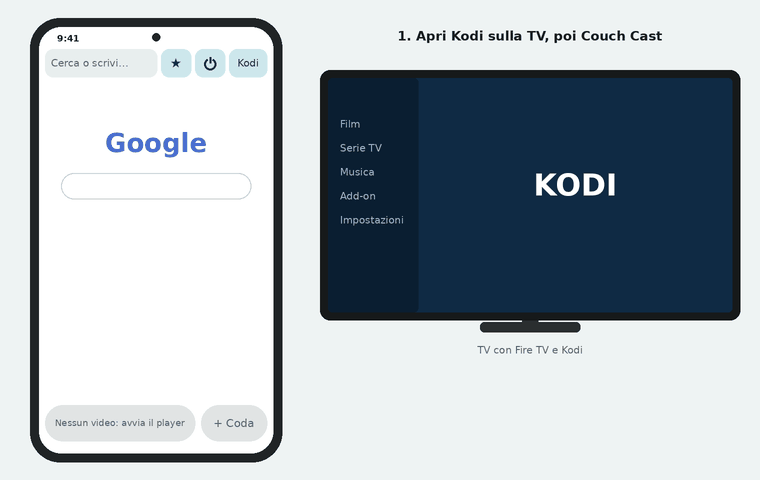
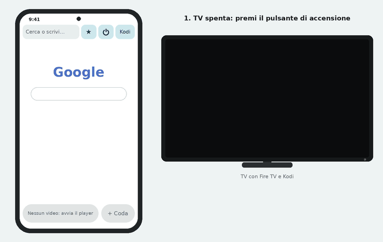
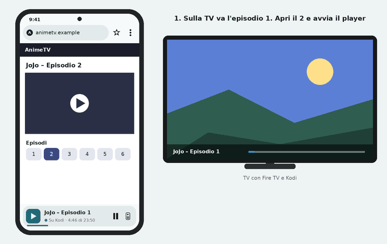
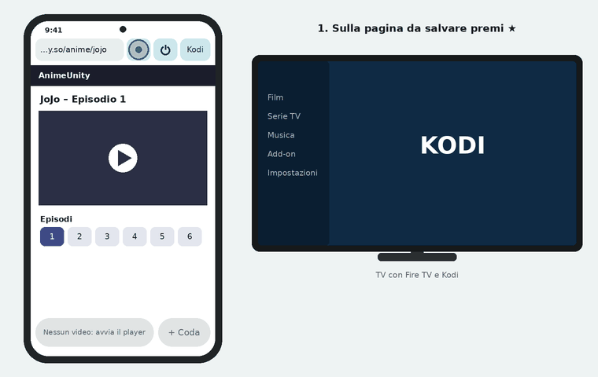

# 📖 Come si usa Couch Cast

🇮🇹 Italiano · [🇬🇧 English](TUTORIAL.en.md)

Guida passo passo, senza termini tecnici. Se qualcosa non va, salta a [Problemi comuni](#-problemi-comuni).

**L'idea in una riga:** il telefono fa da browser e da telecomando, la TV guarda il video con **Kodi**. Tu apri il sito
sul telefono, avvii il video, premi un pulsante e il video parte sulla TV. Poi puoi bloccare il telefono.

> [!IMPORTANT]
> Telefono e Fire TV devono essere collegati **allo stesso Wi-Fi**.

_L'app parla italiano e inglese: segue la lingua del telefono e si cambia in **⋮ → Impostazioni → Lingua dell'app**. Le animazioni di questa guida sono disegni dell'interfaccia della versione 2.1, non registrazioni dello schermo: colori e dettagli dell'app vera possono essere un po' diversi._

## Indice

1. [Cosa c'è sullo schermo](#1-cosa-cè-sullo-schermo)
2. [Prima volta: preparare la Fire TV](#2-prima-volta-preparare-la-fire-tv)
3. [Prima volta: collegare l'app a Kodi](#3-prima-volta-collegare-lapp-a-kodi)
4. [Accendere la TV dal telefono](#4-accendere-la-tv-dal-telefono)
5. [Trovare e aprire un video](#5-trovare-e-aprire-un-video)
6. [Mandare il video alla TV](#6-mandare-il-video-alla-tv)
7. [La coda degli episodi](#7-la-coda-degli-episodi)
8. [Preferiti](#8-preferiti)
9. [Log di Kodi: quando qualcosa non parte](#9-log-di-kodi-quando-qualcosa-non-parte)
10. [Aggiornare l'app e fare un backup](#10-aggiornare-lapp-e-fare-un-backup)
11. [Problemi comuni](#-problemi-comuni)

---

## 1. Cosa c'è sullo schermo

```
┌──────────────────────────────────────────────┐
│ (🌐 animetv.example              🛡3)   ★  ⋮  │  ← barra in alto
│▬▬▬▬▬▬▬▬▬▬▬▬▬▬▬▬▬▬▬▬                            │  ← caricamento della pagina
│                                              │
│              pagina del sito                 │
│                                              │
│                 (+≡)  ( 📺 Manda a Kodi )     │  ← solo quando c'è un video
│ ╭──────────────────────────────────────────╮ │
│ │ [▶] Episodio 11                   ‖   ▯  │ │  ← barra di Kodi, sempre
│ │     ● Su Kodi · 12:40 di 23:50           │ │
│ ╰━━━━━━━━━━━━━━━━──────────────────────────╯ │
└──────────────────────────────────────────────┘
```

| Pulsante | A cosa serve |
|---|---|
| **Barra degli indirizzi** | Scrivi un sito (`wikipedia.org`) o una ricerca (`jojo episodio 1`, va su Google). A sinistra l'icona del sito. Finché non la tocchi mostra solo il nome del sito; toccandola torna l'indirizzo intero. |
| **🛡 con un numero** | Compare quando l'app ha bloccato popup o salti verso altri siti su questa pagina. Toccalo per vedere quali e aprirne uno, se serviva. |
| **★** | I tuoi siti preferiti. Piena se la pagina aperta è già tra i preferiti. |
| **Barra di Kodi** (in fondo) | C'è sempre, appena l'app sa dov'è Kodi. Mostra cosa riproduce, con il tempo, play/pausa e una linea sottile in basso che avanza. Il pallino accanto allo stato è acceso se Kodi risponde. Se Kodi è acceso ma fermo scrive *Acceso, niente in riproduzione*; se è spento o non risponde c'è il pulsante **⏻** per accendere la TV. Il pulsante a destra, o un tocco sulla barra, apre il telecomando con la coda. |
| **⋮** | Un piccolo menu: *Telecomando*, *Coda di Kodi*, *Pagina iniziale*, *Impostazioni* (dov'è Kodi, accensione, episodi successivi, cronologia, tendina, backup, lingua, log di Kodi, guida, versione). |
| **Manda a Kodi** | Fa partire subito sulla TV il video della pagina. Compare in basso a destra, sopra il sito, solo quando sulla pagina parte un video. |
| **+ Coda** (l'icona tonda con le righe e il +, accanto a *Manda a Kodi*) | Mette il video in fondo alla coda di Kodi, senza interrompere quello che stai guardando. Tenendola premuta si apre la coda. |

All'avvio si apre la **pagina iniziale**: in cima Kodi (acceso, spento o cosa sta riproducendo, con il pulsante *Accendi* o *Telecomando*), poi **Continua a guardare** con le serie a cui sei arrivato, l'**ultima pagina** aperta e i tuoi preferiti come icone (vedi [Continua a guardare](#continua-a-guardare)). Ci torni con indietro dalla prima pagina di un sito o con **⋮ → Pagina iniziale**.

Gli avvisi brevi ("Aggiunto alla coda", "Kodi è pronto"…) compaiono in fondo allo schermo, sopra il sito.

---

## 2. Prima volta: preparare la Fire TV

Da fare **una volta sola**, con il telecomando della Fire TV. I passaggi dettagliati per installare Kodi sono nel
[README](../README.it.md#-fire-tv); qui c'è quello che serve all'app.

1. **Installa Kodi** sulla Fire TV (con l'app *Downloader*, vedi README) e aprilo.
2. In Kodi vai su **Impostazioni → Servizi → Controllo** e attiva **Consenti il controllo remoto via HTTP**.
   - Lascia la porta com'è (di solito `8080`).
   - Se imposti **utente e password**, segnateli: l'app te li chiederà.
3. Sempre in Kodi, **Impostazioni → Servizi → Generale**: attiva **Annuncia servizi ad altri sistemi**.
   Serve perché l'app trovi Kodi da sola.
4. Solo se vuoi accendere la TV dal telefono (pulsante **⏻** nella barra di Kodi) e leggere il log di Kodi:
   - Fire TV: **Impostazioni → La mia Fire TV → Opzioni sviluppatore → Debug ADB** = attivo.
     Se *Opzioni sviluppatore* non c'è, vai in **La mia Fire TV → Info** e premi 7 volte sul nome del dispositivo.
   - Fire TV: **Impostazioni → Display e audio → Controllo dispositivi HDMI CEC** = attivo.
   - Sulla TV attiva l'HDMI-CEC (si chiama Anynet+, SimpLink, Bravia Sync… a seconda della marca).
     Se con Alexa la TV si accende già sull'ingresso giusto, è già a posto.

---

## 3. Prima volta: collegare l'app a Kodi

<p align="center"></p>

1. **Apri Kodi sulla TV** (deve essere acceso per farsi trovare).
2. **Apri Couch Cast** sul telefono. Al primo avvio compare la finestra **Dov'è Kodi?**.
3. Scheda **Automatico**: l'app scrive *"Cerco Kodi sul Wi-Fi…"* e dopo qualche secondo mostra quello che ha trovato.
   Tocca il tuo Kodi e premi **Salva**.
4. Se non trova niente, usa la scheda **Manuale** e scrivi `IP:porta`, per esempio `192.168.1.50:8080`.
   L'IP si legge sulla Fire TV in **Impostazioni → La mia Fire TV → Info → Rete**.
5. **Accesso, se impostato in Kodi**: se in Kodi hai messo utente e password scrivili qui. Se li salti, l'app li chiede
   da sola (finestra *Accesso a Kodi*) la prima volta che mandi un video.

Fatto: in fondo compare la **barra di Kodi**, e nella pagina iniziale il riquadro di Kodi mostra il suo nome. Per cambiare
queste scelte in futuro: **⋮ → Impostazioni → Kodi**.

> [!TIP]
> - Se la Fire TV cambia indirizzo (succede dopo un riavvio del router), all'invio l'app la ritrova da sola.
> - La password resta solo sul telefono, cifrata, ed è legata alla rete di casa: su un'altra rete l'app la richiede.

---

## 4. Accendere la TV dal telefono

<p align="center"></p>

Con la TV spenta (in standby) premi **⏻** nella barra di Kodi in fondo (o *Accendi* nella pagina iniziale).

1. L'app cerca la Fire TV in rete (*"Cerco la Fire TV in rete…"*), anche se Kodi è chiuso.
2. **Solo la prima volta**: sulla TV compare la domanda se consentire il debug da questo telefono.
   Spunta **Consenti sempre** e premi **OK** con il telecomando.
3. La TV si accende, dopo qualche secondo passa sull'ingresso della Fire TV e si apre Kodi.
4. Quando Kodi risponde, il telefono scrive **"Kodi è pronto"**.

> [!NOTE]
> Se la Fire TV è in *sonno profondo* (spenta da molto tempo) il suo Wi-Fi è spento e non risponde a nessuno:
> in quel caso accendila con Alexa o con il telecomando.

---

## 5. Trovare e aprire un video

<p align="center"></p>

1. Tocca la **barra in alto** e scrivi il sito o una ricerca, poi premi Invio.
   - `wikipedia.org` → apre il sito.
   - `jojo episodio 1` → cerca su Google; dai risultati di Google puoi aprire qualunque sito.
2. Vai alla pagina dell'episodio o del film.
3. **Avvia il player** (premi play sul video). Questo passaggio è indispensabile: l'app vede il video solo quando parte.
4. In basso a destra, sopra il sito, compaiono **Manda a Kodi** e il pulsante tondo **+ Coda**. Ora puoi anche mettere
   in pausa il video sul telefono.

### Da Chrome o da un'altra app: Condividi → Couch Cast

Hai trovato la pagina dell'episodio in Chrome, o qualcuno te l'ha mandata su WhatsApp? Tocca **Condividi** e scegli
**Couch Cast**: la pagina si apre nell'app e da lì si continua dal punto 3 (avvia il player, poi Manda a Kodi).

- Va bene anche un messaggio con il link in mezzo al testo: l'app prende il primo link.
- Se condividi solo del testo, senza link, l'app lo cerca su Google.
- Se il link è già il video (finisce con `.m3u8` o `.mp4`), si apre un pannello: **Manda a Kodi** lo fa partire subito
  sulla TV, **Apri qui** lo apre nell'app.

> [!TIP]
> La pubblicità che apre finestre o ti porta su altri siti viene bloccata da sola, senza avvisi.
> Se il sito ti sembra "non reagire" a un tocco, probabilmente era un link pubblicitario: tocca di nuovo il play vero.

---

## 6. Mandare il video alla TV

Premi **Manda a Kodi**.

- Il pulsante scrive *"Invio a Kodi…"* finché Kodi non risponde: non serve premere di nuovo.
- Quando ha finito compare **"Inviato a Kodi"** e il video parte sulla TV dopo qualche secondo.
- Se la pagina ha più video il pulsante dice per esempio **Manda a Kodi · 2** e si apre un pannello con tutti i video,
  ognuno con un'**immagine presa dal video** e la **durata** sopra (dopo un paio di secondi). Il primo, *Video completo*,
  è quasi sempre quello giusto: è già scelto, con la scritta *Consigliato* e sotto i pulsanti **Manda** e **In coda**.
  Tocca un altro video per spostare lì i pulsanti. Quelli sotto il minuto sono sbiaditi (*Probabile pubblicità*). Su
  alcuni video protetti l'immagine non arriva e resta solo la durata: puoi scegliere lo stesso. **CC** sull'immagine
  vuol dire che ci sono sottotitoli, con le lingue.
- Da qui il telefono **non serve più**: puoi bloccarlo o usarlo per altro. Il video arriva alla TV direttamente dal sito.

### Il telecomando nell'app

Per comandare Kodi senza il telecomando della TV tocca la **barra di Kodi** in fondo (o **⋮ → Telecomando**). Si apre
a schermo intero con due schede, **Telecomando** e **Coda**; si chiude con ⌄ in alto, con indietro o trascinando giù.
In alto a destra c'è il nome di Kodi con un pallino acceso se risponde. Nella scheda Telecomando, dall'alto:

- **Il video in corso** con l'ora in cui finisce (*fino alle 21:52*), e la **barra**: trascinala fino al punto che
  vuoi; sotto ci sono il tempo passato e la durata.
- **⏮ −10 ⏯ +10 ⏭**: video precedente della coda, indietro di 10 secondi, play/pausa (il pulsante grande), avanti di
  10 secondi, video successivo. I salti sono sempre di quanto c'è scritto: il telecomando della TV invece usa i passi
  di Kodi, e con le frecce su e giù salta di 10 minuti.
- **⏭ a coda finita**: se dopo il video in corso la coda è vuota, sui siti di anime con player VixCloud ⏭ manda a Kodi
  l'episodio dopo della stessa serie (lo prepara il telefono in un paio di secondi, come *Riprendi su Kodi*). Sugli
  altri siti l'app dice quale episodio aprire. Non accende l'accodamento automatico.
- **Salta sigla**: con gli anime che [AniSkip](https://aniskip.com) conosce (un archivio gratuito di tempi segnati dagli
  utenti) va dritto alla fine della sigla, anche se la tocchi prima che parta; se l'episodio ha un riassunto all'inizio
  il tasto dice **Salta riassunto**, e da 30 secondi prima dei titoli di coda diventa **Salta titoli di coda**, che porta
  alla fine dell'episodio (e Kodi passa al video dopo in coda). Senza tempi di AniSkip, quando parte la sigla toccalo e
  il video va avanti da dov'è: la prima volta per ogni serie l'app chiede di quanto (da 30 secondi a 2 minuti, o
  *Altro tempo…* per scriverlo, es. `1:12` o `72`) e poi se lo ricorda. Per cambiarlo tienilo premuto. I video che non
  sono di una serie di *Continua a guardare* hanno un tempo unico per tutti. Non salta mai da solo.
- **La croce tonda con OK** e sotto **Indietro**, **Home**, **volume giù** e **volume su** (il volume di Kodi, non
  quello della TV): per muoverti nei menu di Kodi.
- In una fila che scorre di lato: **Accendi la TV**, **−30 s**, **+30 s**, **Vai al minuto**, **Audio**,
  **Sottotitoli**, **Velocità**, **Muto**, **Menu**, **Scrivi** e **Ferma** (chiede conferma, la coda resta).
- **Vai al minuto**: scrivi per esempio `12:30` (12 minuti e 30 secondi) o `1:02:30`.
- **Velocità**: normale, 1,25x o 1,5x. Con alcuni video Kodi non la cambia, e l'app lo dice.
- **Audio**: scegli la lingua tra quelle del video.
- **Sottotitoli**: un pannello con *Spenti* e le tracce, con "dal sito" sotto quelle prese dalla pagina. Il telefono
  passa a Kodi, insieme al video, sia i sottotitoli della playlist sia i file `.vtt`/`.srt` che il sito carica a parte
  (solo con *Manda a Kodi*: in coda Kodi vede soltanto quelli dentro il video). Su un episodio di una serie di
  *Continua a guardare* c'è **Accendili sempre in italiano** (o nella lingua scelta): negli episodi dopo e in coda
  l'app li accende da sola, finché la barra di Kodi o la tendina sono attive. Se il video non ne ha, **Cerca con
  l'add-on di Kodi** apre sulla TV la ricerca dei sottotitoli di Kodi (serve un add-on come OpenSubtitles).
- **Scrivi**: apri prima in Kodi un campo di testo (per esempio la ricerca), poi scrivi con la tastiera del telefono.
- **Accendi la TV**: come il pulsante ⏻.
- **Timer**: per addormentarsi davanti a un episodio. Scegli quando (**Fine di questo episodio**, **Fine della coda**,
  **Tra 30 minuti**, **Tra 1 ora** o **Altro tempo…**, ognuno con l'ora in cui scatta) e cosa fare (**Pausa**, **Ferma
  il video** o **Spegni la TV**: la Fire TV va in standby e con l'HDMI-CEC si spegne anche la TV). Il timer lo tiene la
  Fire TV, con il Debug ADB come ⏻, quindi il telefono si può spegnere; se la Fire TV non risponde lo tiene il
  telefono, che deve restare acceso. Mentre è attivo il telecomando mostra "Si spegne alle 23:13" con **+15 min** e
  **Annulla**, e la barra di Kodi l'ora del timer.

### Senza aprire l'app: tendina e schermata di blocco

Mentre Kodi riproduce, nella tendina e sulla schermata di blocco compare il **player di Android**, come per la musica:
immagine della serie, titolo, episodio, la barra del tempo (si trascina per andare a un punto) e i tasti **Salta sigla**
(solo se per quella serie hai già scelto il tempo), **−10 s**, **pausa**, **+10 s** e **Prossimo** (se nella coda c'è un
altro video). Toccandolo si apre il telecomando. Con lo schermo spento non parla con Kodi, quindi non consuma; sparisce da
solo quando Kodi si ferma. Si spegne in **⋮ → Impostazioni → Controlli nella tendina**.

In più c'è il riquadro **Couch Cast** delle impostazioni rapide: **⋮ → Impostazioni → Aggiungi il riquadro** (o la matita
della tendina). Dice cosa fa Kodi; un tocco mette in pausa o fa ripartire, con Kodi fermo o spento apre l'app; la pressione
lunga apre il telecomando.

### Le scorciatoie sull'icona

Tieni premuta l'icona di Couch Cast: compaiono **Accendi la TV**, **Telecomando**, **Riprendi** con il nome dell'ultima
serie di *Continua a guardare* (come *Riprendi su Kodi* del widget) e **Coda di Kodi**. Ognuna si può trascinare sulla
Home come icona a sé. Ci sono solo dopo aver scelto Kodi.

### Il widget sulla schermata Home

Tieni premuto uno spazio vuoto della schermata Home → **Widget** → **Couch Cast** e trascinalo dove vuoi; si allarga e si
stringe come gli altri widget. Ha sempre la stessa fila di tasti del telecomando: **⏮ −10 ⏯ +10 ⏭ ⏹**, e sotto (o in alto a
destra, se il widget è basso) **Salta sigla**.

- **Con un video in corso** in alto ci sono immagine, titolo, tempo e ora in cui finisce, la linea che avanza e il pulsante
  che apre il telecomando intero. ⏮ e ⏭ passano al video prima o dopo della coda; a coda finita ⏭ manda l'episodio dopo,
  come nel telecomando (solo sui siti di anime con player VixCloud, e lì si apre l'app per prepararlo). ⏹ ferma Kodi.
  **Salta sigla** compare se per la serie il tempo è già scelto o AniSkip lo sa.
- **Con Kodi fermo** mostra la serie di *Continua a guardare* a cui sei arrivato, con l'immagine e il punto ("Ep. 7 · fermo a
  12:34"), e in alto a destra **⏻** per accendere la TV. Il tasto grande **▶** la riprende su Kodi dal minuto giusto e ⏭ manda
  l'episodio dopo; −10, +10, ⏹ e Salta sigla sono sbiaditi finché il video non parte. Va su Kodi da solo soltanto sui siti
  di anime con player VixCloud, come nel pannello della serie; sugli altri siti ▶ apre la pagina nell'app.
- **Ristretto a una riga** (4×1) restano il nome con il tempo e la fila di tasti; stretto (2 colonne) solo ⏮ ⏯ ⏭.

Il widget non chiede niente a Kodi da solo: lo aggiornano l'app e il player della tendina mentre li usi (e al massimo ogni
30 minuti), così con lo schermo spento non consuma. Per questo, se non apri l'app da un po', può mostrare un tempo vecchio.

---

## 7. La coda degli episodi

La coda **vive dentro Kodi**, non nel telefono: è la playlist video di Kodi. Quando un video finisce, Kodi passa da solo
al successivo. L'app non la cancella mai.

### Manda a Kodi e + Coda: la differenza

<p align="center"></p>

| | Cosa fa |
|---|---|
| **Manda a Kodi** | Mette il video **subito dopo** quello in corso e lo **fa partire ora**. |
| **+ Coda** | Mette il video **in fondo** alla coda. Quello che stai guardando continua. |

**Esempio per vedere tre episodi di fila:**

1. Apri l'episodio 1, avvia il player, premi **Manda a Kodi**. Parte sulla TV.
2. Apri l'episodio 2, avvia il player, premi **+ Coda** → *"Aggiunto alla coda"*.
3. Apri l'episodio 3, avvia il player, premi **+ Coda**.
4. Metti giù il telefono: la TV va avanti da sola 1 → 2 → 3.

### Sui siti di anime con player VixCloud può fare da sola (se la accendi)

Sul sito di anime che conosce (player VixCloud) l'app può mettere in coda da sola gli episodi successivi, così non devi premere **+ Coda** per ognuno.
**Di default è spenta.** Per accenderla: **⋮ → Impostazioni →** la voce degli **episodi successivi** e scegli quanti episodi accodare (massimo 3).
Per una serie sola si cambia dal suo pannello in *Continua a guardare* → **Episodi successivi**.

Da quel momento, dopo **Manda a Kodi** (o **+ Coda**) l'app accoda gli episodi dopo e scrive
*"In coda anche: episodio …"*. Se il sito cambia e l'app non ci riesce, te lo dice: in quel caso usa **+ Coda** a mano.

### Quando l'app non mette in coda (e perché)

A volte **+ Coda** risponde con **"Non messo in coda"**. Non è un guasto, l'app ti evita una coda che non partirebbe:

- *"Il video in corso su Kodi non è partito dall'app"*: Kodi sta riproducendo qualcosa avviato in un altro modo, e alla
  fine non passerebbe alla coda. Premi **Manda a Kodi** sull'episodio da vedere, poi accoda gli altri.
- *"Il link di questo episodio scade alle …"*: alcuni siti danno link che valgono poche ore. Se l'episodio arriverebbe
  dopo la scadenza, mettilo in coda più tardi.

### Guardare e sistemare la coda: la scheda Coda

Apri il telecomando e tocca la scheda **Coda** (il numero accanto dice quanti video aspettano), oppure tieni premuto
**+ Coda**. Vedi l'elenco dei video:

- **▶ In riproduzione · finisce alle 21:52**: quello che va ora.
- **Già visto**: quelli finiti, più chiari.
- **Parte alle 22:16**: quelli in attesa, con l'ora stimata (episodi lunghi come quello in corso).
- In rosso, con l'orologio, **Il link scade prima del suo turno** o **Link scaduto**: va rimandato dalla pagina
  dell'episodio.

Con **⋮** accanto a un video scegli **Riproduci ora** o **Togli dalla coda**. **Svuota la coda** toglie tutto tranne
quello in corso, **↻** rilegge la coda da Kodi.

---

## 8. Preferiti

<p align="center"></p>

- **Salvare una pagina**: aprila, premi **★** e poi **＋ Aggiungi questa pagina**. Scegli un nome e salva.
- **Riaprirla**: tocca la sua icona nella **pagina iniziale**, oppure **★** e tocca il nome.
- **Rinominare o togliere**: tieni premuta l'icona nella pagina iniziale, oppure **★** e **⋮** accanto al preferito →
  **Rinomina** o **Togli**.
- La **★** in alto è piena quando la pagina aperta è già tra i preferiti.

### Continua a guardare

Quando mandi a Kodi un episodio, l'app se lo ricorda. Nella pagina iniziale, sotto Kodi, trovi **Continua a guardare**:
una fila che scorre di lato, con una scheda per ogni serie, la più recente a sinistra.

- La scheda dice a che episodio sei e a che minuto ti sei fermato (es. *Ep. 12 · fermo a 12:40*), con una linea che
  mostra quanto ne hai visto. Quando Kodi passa il 95% dell'episodio, o mancano meno di 2 minuti alla fine (la sigla),
  l'episodio è visto e la scheda passa al prossimo (*Visto il 12 · tocca al 13*).
- **Toccala**: sale un pannello con l'episodio prima, quello in corso e il prossimo. **Riprendi su Kodi** manda
  l'episodio senza aprire la pagina e Kodi riparte dal minuto in cui eri (solo sul sito di anime con player VixCloud). **Apri qui** apre la pagina
  dell'episodio: sugli altri siti avvii il player, premi *Manda a Kodi* e Kodi riparte comunque da dove eri. Dal
  pannello puoi anche segnare l'episodio come visto.
- **Impostazioni della serie**, in fondo al pannello:
  - **Nome**: lo scrivi tu e il sito non lo cambia più.
  - **Sfondo**: la **copertina** della serie o un'**immagine dell'episodio**, presa a caso tra il 25% e il 60% del
    video (dopo la sigla); con *Cambia intervallo…* scegli tu da che punto a che punto, in percentuale. La stessa
    immagine compare nella barra di Kodi in fondo.
  - **Salta sigla**: di quanto va avanti il tasto del telecomando con questa serie quando AniSkip non ha i tempi.
  - **Tempi da AniSkip**: quale serie è su MyAnimeList. Di solito la trova da sola; se dice *Serie non trovata*,
    toccala, scegli quella giusta dall'elenco (copertina, anno ed episodi aiutano a distinguere stagioni e parti) o
    *Cerca con un altro nome…*; *Nessuna* lascia solo il salto fisso. AniSkip si spegne in *⋮ → Impostazioni*.
  - **Riprendi**: dal punto esatto o qualche secondo prima (5, 10, 15, 30), per ritrovare il filo.
  - **Episodi successivi** (solo sul sito di anime con player VixCloud): quanti accodarne da soli per questa serie, o
    come nelle Impostazioni.
- Una serie arrivata all'ultimo episodio resta sbiadita, con scritto **Finita**, finché non la togli.
- **Togliere una serie**: la **✕** in alto a destra sulla scheda. La scheda diventa rossa e chiede *Togli …?*: tocca
  **Togli** (se non tocchi niente, dopo 4 secondi torna com'era). Subito dopo puoi ancora premere **Annulla**
  nell'avviso in fondo.
- Sotto c'è l'**Ultima pagina** aperta, se non è già un episodio della fila: la ✕ la toglie al primo tocco, con
  *Annulla*.
- Se dal sito (o da Google) apri una serie che stai guardando ma su un altro episodio, sotto la barra compare
  **Eri all'episodio 12** con **Vai**.
- I siti cambiano spesso dominio: l'app riconosce la serie dal nome del sito e dalla parte dell'indirizzo che resta
  uguale, e la riapre sull'ultimo dominio che ha visto funzionare.
- **⋮ → Impostazioni → Cronologia**: *Ricorda dove sono arrivato* (spento, l'app non salva niente e la pagina iniziale
  non mostra serie né ultima pagina) e *Cancella la cronologia*.

Il minuto l'app lo legge da Kodi mentre è aperta; se il telefono era bloccato, quando torni alla pagina iniziale lo
chiede a Kodi, che di solito se lo ricorda. Su quel sito serie e numero vengono dall'indirizzo e dal player; sugli
altri siti dal titolo della pagina ("Episodio 5", "S2E5"): se il titolo non li dice, la pagina resta solo come ultima
pagina.

---

## 9. Log di Kodi: quando qualcosa non parte

Se sulla TV compare **Playback failed** o il video non parte:

1. Premi **⋮ → Impostazioni → Log di Kodi**. L'app legge dalla Fire TV le ultime righe del registro di Kodi
   (serve il *Debug ADB* del [passo 2](#2-prima-volta-preparare-la-fire-tv); la prima volta la TV chiede di confermare,
   come per ⏻).
2. Premi **Condividi** e mandalo dove ti serve (WhatsApp, email, una issue su GitHub…), insieme al nome del sito e
   dell'episodio.

---

## 10. Aggiornare l'app e fare un backup

All'avvio, se c'è una versione nuova, si apre il pannello **Nuova versione** con le novità. Premi **Aggiorna**: l'app
scarica l'APK (con la barra che avanza) e Android chiede di confermare l'installazione sopra quella vecchia (non serve
disinstallare, i dati restano). La prima volta Android chiede di consentire a Couch Cast di installare app: consenti,
torna indietro e premi di nuovo **Aggiorna**. Se qualcosa va storto, **Apri GitHub** apre la pagina della release nel
browser. Per controllare a mano: **⋮ → Impostazioni → Versione**. Anche **Obtainium**, con l'indirizzo del repo,
continua a funzionare.

### Backup: cambiare telefono o reinstallare l'app

1. **⋮ → Impostazioni → Salva un backup**. Il pannello dice cosa c'è nel file: **Preferiti**, **Continua a guardare**
   (le serie con le immagini e l'ultima pagina) e **Impostazioni** (Kodi, sigla, episodi successivi, lingua). Togli la spunta a
   quello che non vuoi.
2. Lascia **Aggiorna questo file ogni settimana** se vuoi che l'app lo riscriva da sola: lo fa all'avvio, se l'ultimo
   backup ha più di una settimana.
3. **Scegli dove salvarlo**: Drive, Download o un'altra cartella. Il file si chiama `couchcast-` con la data, `.zip`.

Per ritrovare tutto: **⋮ → Impostazioni → Ripristina da un backup**, scegli il file e guarda cosa contiene rispetto al
telefono. **Unisci** aggiunge quello che manca (per una serie tiene l'episodio più avanti, le impostazioni del telefono
restano), **Sostituisci tutto** riporta il telefono com'era nel backup. Subito dopo l'avviso in fondo ha **Annulla**.

Password di Kodi e chiave della Fire TV non vanno nel file, apposta: sono cifrate con una chiave che non esce dal
telefono. Dopo il ripristino l'app chiede la password di Kodi al primo invio, e la TV chiede di nuovo *Consenti* al
primo ⏻.

---

## 🩺 Problemi comuni

| Cosa vedi | Cosa fare |
|---|---|
| **Manda a Kodi** non compare | Premi play sul video della pagina e aspetta che parta davvero. Se c'è una pubblicità prima del video, aspetta che finisca. |
| **"Kodi non risponde"** / **"Nessun Kodi trovato"** | Kodi deve essere **aperto** sulla TV, con *Annuncia servizi ad altri sistemi* attivo, e telefono e TV sullo stesso Wi-Fi. Altrimenti **⋮ → Impostazioni → Kodi → Manuale** e scrivi `IP:porta`. |
| Finestra **Accesso a Kodi** | Scrivi utente e password che hai impostato in Kodi (*Servizi → Controllo*). Se dice che non li accetta, ricontrollali in Kodi. |
| Sulla TV **Playback failed** | Riprova una volta **Manda a Kodi**. Se ricapita, [⋮ → Impostazioni → Log di Kodi → Condividi](#9-log-di-kodi-quando-qualcosa-non-parte). |
| **"Kodi non ha accettato il video"** | Il sito ha dato un link che Kodi non sa aprire. Ricarica la pagina, riavvia il player e riprova; se ricapita, manda il log. |
| **"Inviato a Kodi, ma senza coda"** | Il video parte, ma Kodi non lo vuole nella playlist: per quel video la coda non funziona. |
| **"Non messo in coda"** | Leggi il motivo nel messaggio: vedi [Quando l'app non mette in coda](#quando-lapp-non-mette-in-coda-e-perché). |
| **"Link scaduto"** nella scheda Coda | Riapri la pagina dell'episodio, avvia il player e rimandalo. |
| **⏻**: **"Fire TV non trovata"** o **"Fire TV non raggiungibile"** | Controlla *Debug ADB* sulla Fire TV e lo stesso Wi-Fi. Se la Fire TV è spenta da tanto è in sonno profondo: accendila con Alexa o con il telecomando. |
| **⏻**: **"La TV ha rifiutato il telefono"** o **"non ha confermato in tempo"** | Premi di nuovo ⏻ e sulla TV spunta *Consenti sempre* e premi OK. |
| **⏻**: la TV si accende ma resta su un altro ingresso | Controlla che l'HDMI-CEC sia attivo sia sulla Fire TV sia sulla TV, poi cambia ingresso con il telecomando della TV. |
| Un tocco sul sito "non fa niente" | Era quasi sicuramente pubblicità bloccata. Tocca il pulsante vero. |
